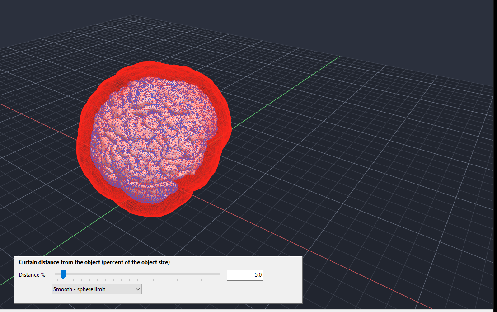
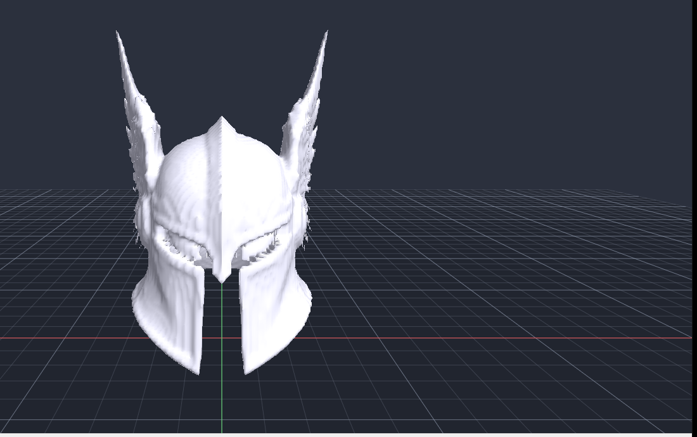

# Doppler's 3D Curtain


A Windows tool that wraps a **mathematical curtain** around a 3D model, for use in a procedural game engine, and turns a **picture into a 3D model** with the Hunyuan3D 2.0 shape network (own port, no ComfyUI needed).

The curtain is a smooth shell at a chosen distance from the object that follows its curves. It is kept as a **signed distance field** on a grid: for any point in space, one trilinear lookup (8 reads) tells how far the point is from the curtain (negative inside). That is cheap enough for an engine, and it is what the exports contain.


*The tool bar (hover a button for a hint): Open, Save, Save As, Undo, Redo, Curtain distance, Curtain precision, Wrap density, Object size, Rotate, Move, Object details, Eraser.*



*Editing the curtain: it is red and translucent, the vertices of the object are blue.*

 

## Curtain settings

| Setting | What it does |
|---|---|
| **Distance** | How far the curtain is from the object (percent of the object size). The further, the closer to a clean sphere ("Smooth - sphere limit"), or to the object's convex hull plus the distance ("Convex hull - distance"). |
| **Precision** | The *fidelity* of the wrap: grid cells along the longest side (16 - 384). High precision follows every curve like a vinyl wrap on a car; low precision cuts the corners on the turns. It does **not** change how many vertices the wrap has. |
| **Wrap density** | The number of vertices of the wrap mesh (200 - 2 000 000), independent of the precision. Fewer: surface-preserving edge collapse (the wrap stays closed). More: the triangles are subdivided and the new vertices are moved onto the same surface. |
| **Hide object** | Leaves only the wrap in the 3D view. |

Colours: object vertices are blue, the curtain is red while you edit it and yellow in the view mode (button **Curtain**, with a transparency slider).

## 3D view

The controls follow Ultimaker Cura: right mouse button rotates and tilts, middle button (or Shift + left) pans, the wheel zooms, left drag on the object moves it on the plate. The vertical stack on the left switches the view: Center, Left, Right, Front, Back, Top, Bottom. Tools show Cura-like handles in the view: move arrows, size boxes, rotation rings; the sliders and number boxes sit over the view. Undo and Redo keep 200 steps.

**Eraser**: a ball (its size is the brush size in the panel) slides over the surface under the mouse, about half sunk into the object. The vertices inside the ball are shown in red: they are the ones that will be deleted, on the front and on the back, loose shards included. Drag to erase. Before a vertex goes, the vertices that were connected to it are collected, and the hole is closed with new triangles (ribs) between exactly those neighbours; the new ribs never duplicate an existing edge, so the surface stays closed and manifold. Tiny loose fragments that a stroke leaves are swept up at its end. One stroke is one undo step.

**Object details** removes a share of the object's vertices (0 - 100 %, steps of 0.01 %): a grid of 10000 x 10000 x 10000 cells is laid over the object, the vertices of the cells that "fall out" are merged into their nearest kept neighbour, so the holes close.

## Files

* **Open:** OBJ, STL, PLY, OFF, glTF / GLB, **STEP / STP**, `.curtain` projects, and pictures (PNG, JPG, BMP: opened in an Image tab). Each file is a tab; drop files on the window.
  STEP files are read with OpenCascade (in `d3c_step.dll`): the curved, trimmed B-rep faces are turned into a watertight triangle mesh (a test part with a cylindrical hole and a sphere came back with the exact bounding box and a volume within 0.002 % of OpenCascade's own value). Plain faceted STEP files (a list of triangles, like the ones this program writes) are read directly and fast: 673 000 triangles in 1.2 s.
* **Save** writes a `.curtain` project (the mesh, the transform, the curtain settings and the fitted field). **Save As** and **File > Export > Object** also write the edited object, with its size, rotation and position applied, as: **STL** (binary), **OBJ**, **STEP** (a faceted solid: one planar face per triangle, millimetres, readable by CAD programs), **GLB**, **glTF** (+ `.bin`), **PLY** (binary), **3MF**, **OFF**. The same formats are available for the curtain surface (the wrap as a mesh).
* Export for the engine: **C++ header** (`.h` with a `<name>_eval(x, y, z)` function) and **binary field** (`.cvf`).
## Image to 3D



Open a picture (PNG, JPG, BMP) in a tab, set the options and press **Convert to 3D**. The job goes to the shared queue (double-click a job to cancel it); the finished model opens in a new tab, upright on the plate, ready for the curtain.

This is a **port of the Hunyuan3D 2.0 shape network that runs without ComfyUI**, on ggml (CPU or CUDA): the DINOv2-giant image encoder, the Flux-style flow-matching transformer with classifier-free guidance (Euler, 20 steps by default), the shape decoder, and surface extraction. Each stage was checked against the numbers of ComfyUI's own pipeline: the image preprocessing matches PyTorch exactly, the transformer matches to 1e-3 or better, the decoder to 1e-5 (`tools/h3d_ref.py`, `tools/h3d_test.cpp`).

| Option | Meaning |
|---|---|
| Seed | the random start of the shape (a new one every time with *Random seed*) |
| Steps, CFG | sampler steps (default 20) and guidance (default 8), as in the ComfyUI workflow |
| Voxel resolution | size of the distance volume the surface is taken from (default 256) |
| Surface threshold | the level of the surface in that volume (default 0.7) |

Notes: the picture is padded with white to a square (transparent areas become white); the shape only, no textures. A CUDA card is strongly advised: one network pass takes about 0.7 s on an RTX 3080 Ti and about 28 s on the processor. A whole picture takes about 45 s at the default resolution 256 and about 1 minute at 384 on that card. The distance volume is decoded coarse to fine (every 4th point first, then only the cells near the surface), which is 5 times faster than decoding every point and gives the same occupancy to 0.01 %. On first start a window offers the **CUDA libraries** and the **Hunyuan3D model** (4.9 GB) for download, with progress, cancel and resume.
## Command line

`d3c.exe` is a console program with the same core, made for scripts and for Claude Code. See [docs/CLI.md](docs/CLI.md).

```
d3c image2mesh picture.png --out model.glb --seed 1 --json   # picture to 3D
d3c info model.glb --json
d3c curtain model.glb --mode smooth --distance 5 --precision 192 --density 20000 --out wrap.obj --header wrap.h --cvf wrap.cvf --project model.curtain --json
```

## Building

Needs the toolchain in `c:\workenv` (w64devkit, ninja, cmake), the same as Dopplers Bakery. STEP import needs OpenCascade 7.9 built once with MinGW as shared libraries (modules DataExchange, ModelingAlgorithms; `OCCT_ROOT` in `CMakeLists.txt` points at the build); without it everything else still builds and STEP files report that `d3c_step.dll` is missing:

```
build.bat      dist\Dopplers3DCurtain.exe   the window
               dist\d3c.exe                 the command line
```

`tools\core_test.cpp` checks the core without a window; `tools\drv.ps1` drives the window through messages for tests.

## Third-party code

* **ggml / llama.cpp** (MIT): `third_party/ggml`, runs the Hunyuan3D network.
* **OpenCascade Technology 7.9** (LGPL 2.1 with the OCCT exception): used only through the separate `d3c_step.dll` and its own DLLs (`libTK*.dll`), which are shipped as they are and can be replaced.
* The Hunyuan3D 2.0 model weights are downloaded from Hugging Face under their own license (Tencent Hunyuan 3D 2.0 community license).

## License

Same terms as Dopplers Bakery: **free for personal use; enterprise use requires US$100 per workstation** (see [LICENSE](LICENSE)).
